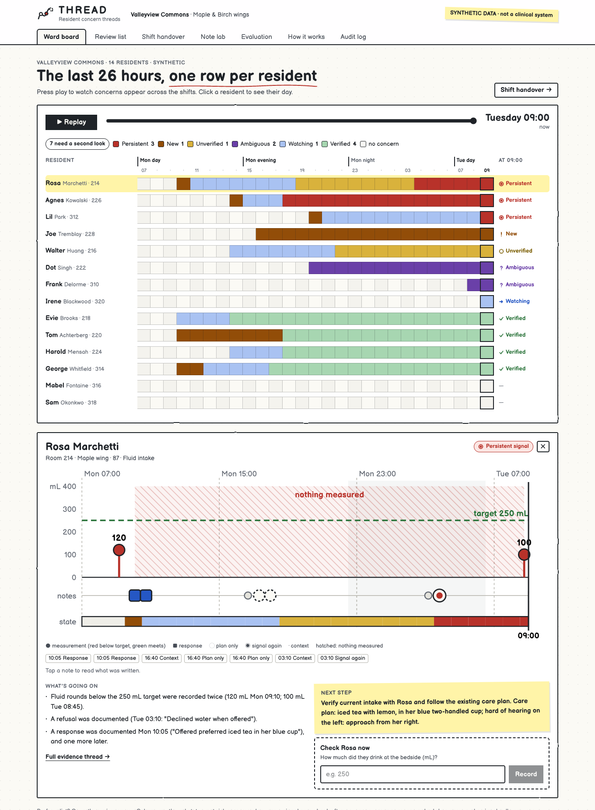
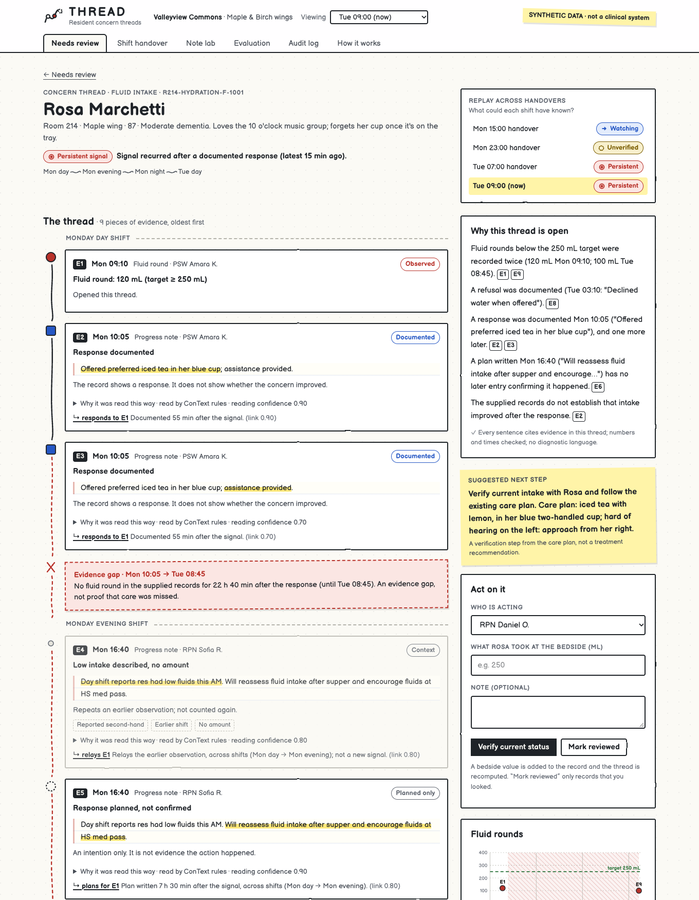
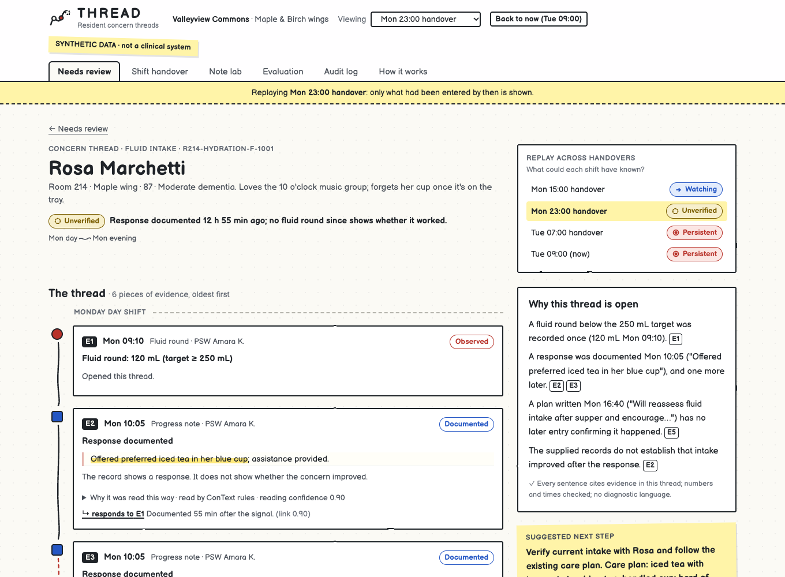
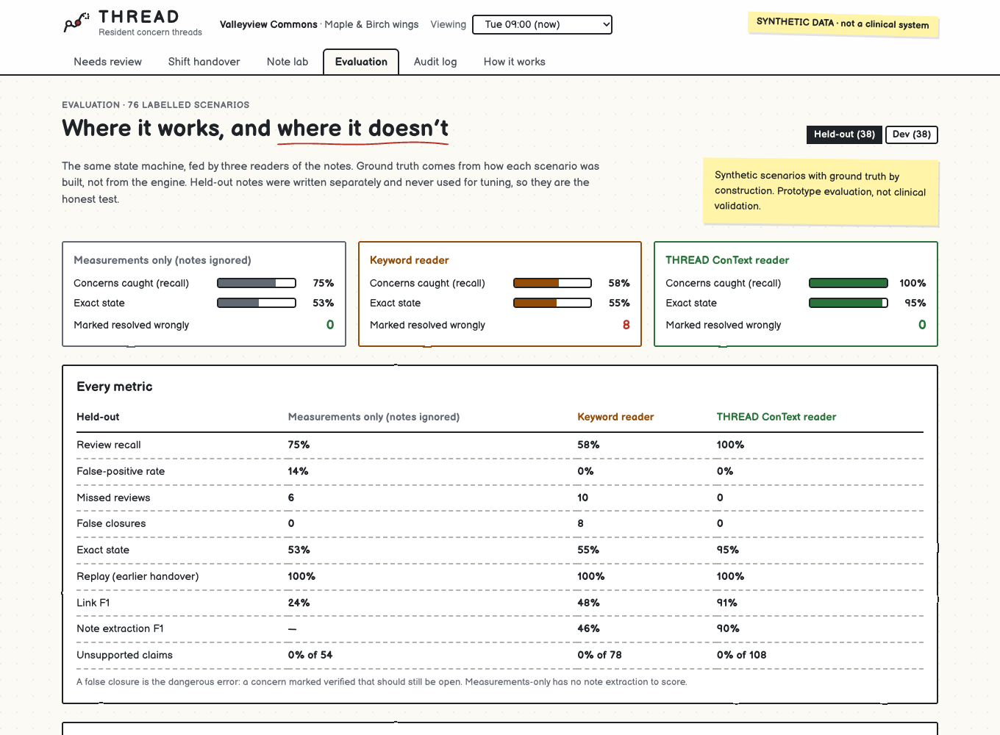

# THREAD

**Traceable Health Risk Escalation & Action Detection.** A care-team copilot that reconstructs how a resident's concern
evolves across measurements, progress notes, interventions and shift handovers, and shows when the evidence still
doesn't establish that the concern has been resolved.

Built for the PointClickCare **Catch It Early** challenge at Hack the Valley. All residents, staff and notes are fictional.

**Live preview:** https://anaybaid7.github.io/thread-pcc/ (a static build of the engine's output; run it locally to act
on threads and paste your own notes)



Press **▶ Play** on the ward board to watch the last 26 hours: concerns appear, change colour and close across the
shifts. Click any resident to see their day as a picture and record a bedside check.

## The idea in one resident

Monday 09:10, Rosa's fluid round is 120 mL against her 250 mL target. At 10:05 a PSW writes *"Offered preferred iced tea
in her blue cup; assistance provided."* Nothing else is measured all afternoon. The evening RPN writes *"Will reassess
fluid intake after supper."* No later entry confirms it. At 03:10 the night PSW notes *"Declined water when offered."*
Tuesday 08:45, another low round.

Every entry is reasonable. No single screen shows the story. THREAD does:



- The **response is documented**, but it is never treated as the **outcome**: an offer is not a drink.
- The **plan** is shown as an intention, never as something that happened.
- The afternoon is drawn as an **evidence gap**, explicitly *not proof that care was missed*.
- The night refusal links the evening to the morning across **four shifts**.
- The explanation cites every claim (`E1`, `E9`, …) and passes a validator that rejects uncited numbers and diagnostic
  or blaming language.
- The next step is a **verification step in Rosa's own terms**: iced tea in her blue two-handled cup, approached from
  her right because she is hard of hearing on the left.

**Replay** shows what each handover could have known: response documented at 15:00, unverified at 23:00, persistent by
07:00.



## What it does

| Screen | What it answers |
|---|---|
| **Ward board** | Every resident, every hour, coloured by thread state, with a time slider and play button. Click a resident for their day at a glance: rounds against target, note icons, the stretch where nothing was measured, and a "check now" box. |
| **Review list** | Who needs a second look, and why: ranked by reason (recurring, unanswered, unverified, unclear), never by an opaque score. Unlinked evidence stays in front of a person. |
| **Concern thread** | The thread itself across shift bands: each source note with the exact span read, event vs entry time, the cues that decided each reading, links with reasons, evidence gaps, replay and actions. |
| **Shift handover** | Three to five items the incoming shift should verify, drafted from cited evidence, editable, with what is new since the last handover. |
| **Note lab** | Paste a note. See THREAD's reading beside what a keyword matcher would conclude, then add it to the record and watch the thread change. |
| **Evaluation** | 76 labelled scenarios, three readers, held-out phrasings, every error listed. |

"Verify current status" records a bedside value and recomputes the thread. "Mark reviewed" is logged but **never**
resolves a concern.

## How it works

```
records ──► normalize ──► read notes ──► link ──► decide ──► explain
            target,       ConText-style   same      six-state   cited sentences,
            event vs      negation, plan  resident, machine,    validated
            entry time,   vs done,        concern,  replayable
            duplicates    offered vs      window
                          drank, hedges,
                          experiencer
```

- **Read notes** is a ConText-style clinical-NLP reader (the algorithm family behind NegEx). It decides whether each
  concept is done, planned, negated or hypothetical, current or relayed from an earlier shift, and about this resident
  or someone else. An optional language-model reader proposes events through a structured tool call; every quote must
  appear verbatim in the note or the proposal is rejected, and amounts are compared with the care plan by the same rules.
- **Decide** is deterministic, with six states and never `resolved: true/false`: `new_signal`, `response_documented`,
  `outcome_verified`, `persistent_signal`, `unverified`, `ambiguous`. The resolution window is labelled everywhere as a
  demonstration rule, not clinical guidance.
- Threads are **never stored**. They are recomputed from the records on every request, so any screen can be reproduced.

## Evaluation

The same state machine, fed by three readers. Ground truth comes from how each scenario was built, not from the engine.
Held-out phrasings were written separately and never used for tuning.

**Held-out (38 scenarios)**

| | Measurements only | Keyword reader | THREAD |
|---|---|---|---|
| Concerns caught (review recall) | 75% | 58% | **100%** |
| False-positive rate | 14% | 0% | **0%** |
| Concerns wrongly marked resolved | 0 | **8** | **0** |
| Exact state | 53% | 55% | **95%** |
| Link F1 | 24% | 48% | **91%** |
| Note extraction F1 | — | 46% | **90%** |
| Unsupported claims in explanations | 0 of 54 | 0 of 78 | **0 of 108** |

What THREAD still gets wrong on held-out notes, kept rather than tuned away: *"Pls encourage fluids"* and *"Need to
push fluids"* are read as done instead of planned, *"recheck"* is not recognised, and *"would not drink"* after a refusal
is counted twice. On dev, a resident drinking "a full glass with lunch" opens a short thread, because a single drink is
compared with a per-round target.



This is prototype evaluation on synthetic scenarios, not clinical validation.

## What THREAD does not do

It does not diagnose, predict falls or transfers, recommend treatment, mark a concern resolved because someone did
something, blame anyone for a gap in the record, or touch real resident data. PointClickCare already offers
change-in-condition workflows (eINTERACT) and early detection (Nursing Advantage); THREAD prototypes one narrower
interaction and does not claim those capabilities don't exist. See
[How it works](https://anaybaid7.github.io/thread-pcc/method/) and [docs/PITCH.md](docs/PITCH.md).

## Run it

Needs Python 3.11+ and Node 20+. No API key, cloud account or database server.

```bash
make setup   # Python venv + web dependencies
make dev     # API on :8000, app on http://localhost:3000
make test    # engine and API tests, web typecheck and lint
make eval    # rerun the evaluation (writes data/evaluation.json)
make reset   # back to the seeded Tuesday 09:00
```

Optional language-model reader: set `ANTHROPIC_API_KEY`, then run `.venv/bin/thread llm-warm` to cache readings of every
note so the demo and the evaluation run offline. The Note lab then shows the model's reading and any proposals it rejected.

## Repository

| Path | |
|---|---|
| `engine/thread_engine/` | `model.py` (states and events), `facility.py` (the synthetic home), `normalize.py`, `extract/` (ConText reader, keyword baseline, LLM reader), `link.py`, `decide.py`, `explain.py`, `scenarios.py`, `evaluate.py` |
| `api/thread_api/` | FastAPI service, SQLite store, response builders shared with the static snapshot |
| `web/` | Next.js app with the Balsamiq-style wireframe design system |
| `docs/PITCH.md` | 90-second demo script, judge Q&A, limitations |

Work was planned and tracked as [issues](https://github.com/anaybaid7/thread-pcc/issues?q=is%3Aissue) and
[milestones](https://github.com/anaybaid7/thread-pcc/milestones); each commit closes one.
