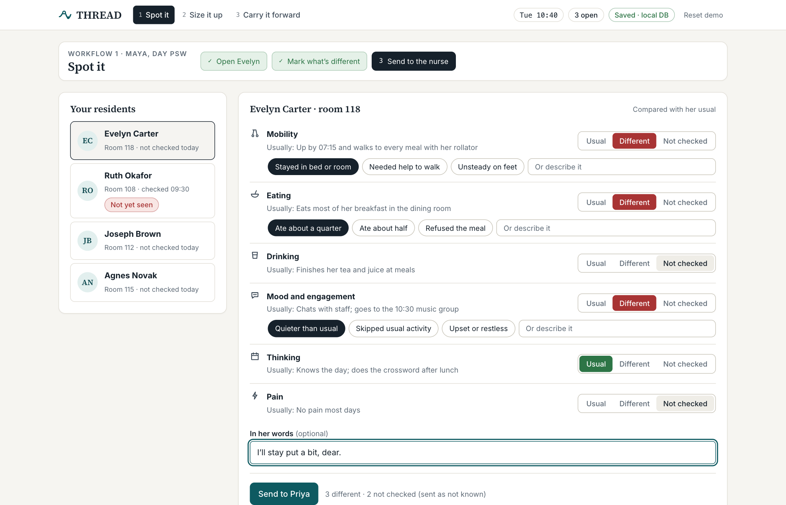
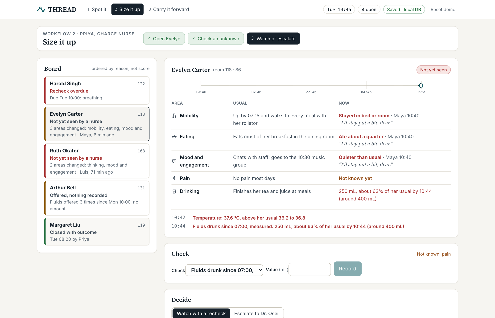
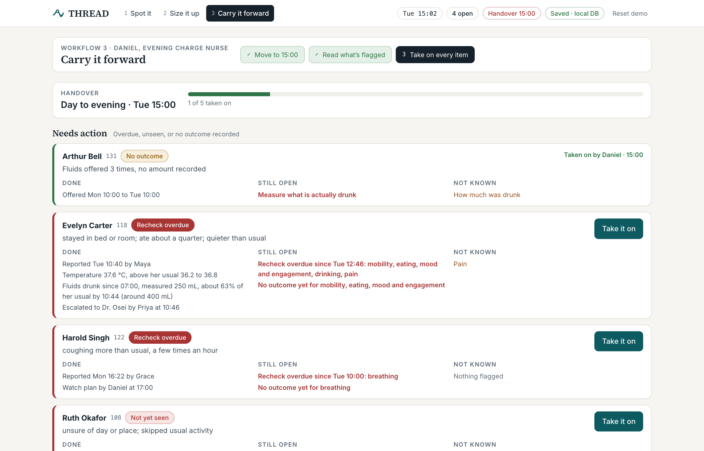

# THREAD

**Catch it early. Then don’t drop it.**

Early signs of decline in long-term care are rarely missed by everyone. They get lost along the way. A PSW notices
and nobody hears about it. The nurse hears about it but doesn't check. It gets checked, then nothing is followed up at
the shift change. THREAD carries each change from the person who sees it to a recorded outcome.

Built for the PointClickCare **Catch It Early** challenge. Residents, staff and ranges are fictional.

**Try it:** https://anaybaid7.github.io/thread-pcc/ (practice mode, runs in your browser)


## Three workflows

| | Who | What they do | What THREAD enforces |
|---|---|---|---|
| **1 · Spot it** | PSW, 20 s | Checks a resident against *their own* usual (mobility, eating, drinking, mood, thinking, pain) and sends what’s different to the nurse. | Anything not checked is sent as **not known**, never assumed fine. |
| **2 · Size it up** | Charge nurse, 2 min | Opens the board, sees who to see first and why, checks what nobody knows yet, then watches with a timed recheck or escalates with an SBAR. | Readings are compared with the resident’s **own** ranges. A concern closes only on a **recorded outcome**. |
| **3 · Carry it forward** | Next shift, 1 min | Gets a handover built from open items: overdue rechecks, reports no nurse has seen, drinks offered but never measured. | **Every item must be acknowledged.** Nothing goes unowned. |

| | |
|---|---|
|  |  |
|  | **Demo in 3 minutes:** [docs/PITCH.md](docs/PITCH.md) |

The board is ordered by explicit reasons (recheck overdue, not yet seen by a nurse, offered with nothing recorded,
watching). There is **no risk score**.

## How it’s built

```
engine/   the ward: residents' usual, events, concerns, board, handover, SBAR facts (pure TypeScript, deterministic)
server/   Fastify API: workspaces with an append-only command log in PostgreSQL (Vultr), Gemini SBAR drafts
web/      Next.js: the three workflows; saved mode via the API, practice mode in the browser
e2e/      Playwright: all three workflows, saved and practice, desktop and phone, axe WCAG 2.1 AA
```

- **Event-sourced.** The ward is never stored as state. It is replayed from a seed plus every command people sent,
  so any screen can be reproduced and every flag traced. Commands carry a sequence number, so a stale tab can't
  overwrite.
- **Gemini, for the escalation SBAR only.** It sees just the facts recorded for that concern. Drafts with a number
  not in the record, or with diagnosis or treatment language, are rejected for a template. The nurse edits before
  sending.

## Run it

Node 22+. No database server or key needed: without `DATABASE_URL` the API uses embedded PostgreSQL (PGlite).

```bash
make setup   # install
make dev     # API :8000, app http://localhost:3000
make test    # engine and server tests
make e2e     # the three workflows in Chromium
```

| Variable | |
|---|---|
| `DATABASE_URL` | PostgreSQL URL. For Vultr: Databases → your cluster → Connection Details → Copy PostgreSQL URL |
| `DATABASE_CA_CERT` | Path to Vultr’s signed certificate, for `verify-full` (otherwise TLS `require`) |
| `GEMINI_API_KEY`, `GEMINI_MODEL` | Server-side only; default model `gemini-3.8-flash` |
| `THREAD_API_ORIGIN` | Where the web app proxies `/api`; read at **build** time |

Not yet exercised against a live Vultr cluster or a live Gemini key; both fall back explicitly.

Prototype. Not clinical advice; not a substitute for staff assessment or facility procedures.
